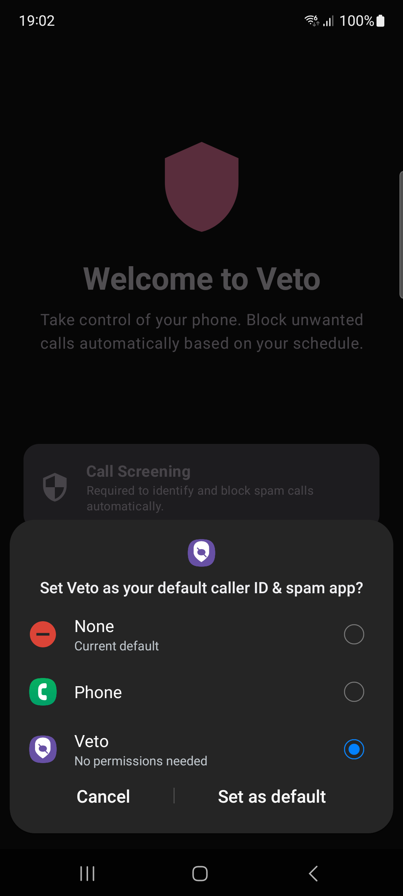
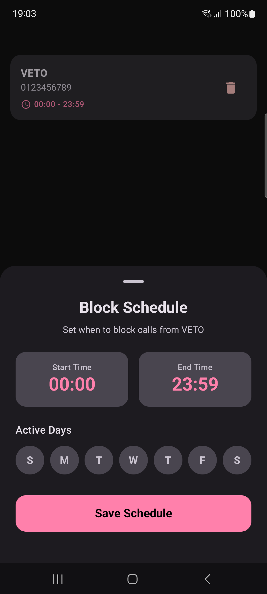
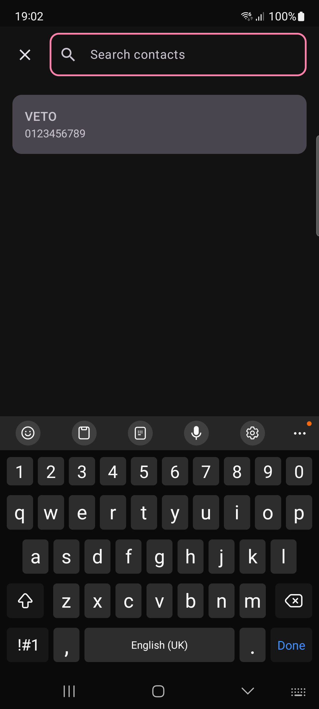

# Veto - Smart Call Blocker

Veto is a modern call blocking application for Android, designed to filter unwanted calls based on advanced criteria. Built with Jetpack Compose and following modern Android development best practices.

## 🚀 Features

- **Advanced Call Blocking:** Uses Android's `CallScreeningService` API for effective system-level blocking.
- **Scheduled Blocking:** Block specific contacts only during certain hours of the day or specific days of the week.
- **Call Logs:** Detailed history of blocked calls.
- **Contact Integration:** Easily add contacts from your phonebook to the block list.
- **Modern UI:** Smooth and user-friendly experience using Material 3 and Jetpack Compose.
- **Easy Setup:** Onboarding screen that guides through necessary permissions and the "Call Screening" role.

## 🛠 Tech Stack

- **Language:** [Kotlin](https://kotlinlang.org/)
- **UI Framework:** [Jetpack Compose](https://developer.android.com/jetpack/compose)
- **Dependency Injection:** [Hilt](https://developer.android.com/training/dependency-injection/hilt-android)
- **Database:** [Room Persistence Library](https://developer.android.com/training/data-storage/room)
- **Navigation:** [Jetpack Navigation](https://developer.android.com/guide/navigation)
- **Architecture:** MVVM (Model-View-ViewModel) with Unidirectional Data Flow (UDF)
- **Background Processing:** Call Screening Service

## 📦 Installation

1. Clone the repository:
   ```bash
   git clone https://github.com/username/veto.git
   ```
2. Open the project in Android Studio.
3. Wait for Gradle sync to complete.
4. Run on an Android device or emulator (Android 10+ recommended).

## 📸 Screenshots

| Onboarding                                | Block List                               | Contacts                              |
|-------------------------------------------|------------------------------------------|---------------------------------------|
|  |  |  |

## 🛡 Permissions

The app requires the following permissions to function correctly:
- `READ_CONTACTS`: To select contacts from the phonebook.
- `ANSWER_PHONE_CALLS` & `READ_PHONE_STATE`: To monitor call status.
- `Call Screening Role`: To reject calls at the system level.

## 📄 License

This project is licensed under the MIT License - see the [LICENSE](LICENSE) file for details.
